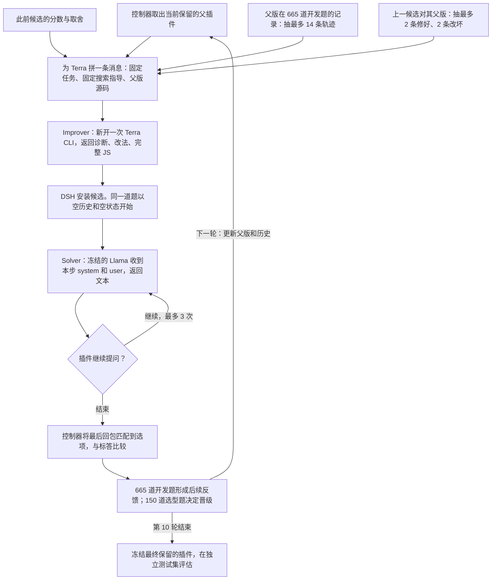
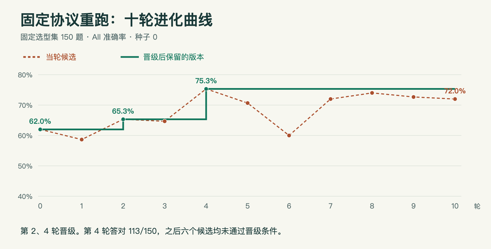
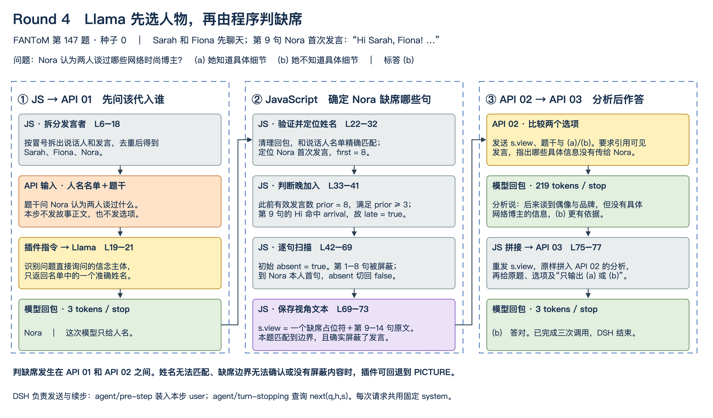
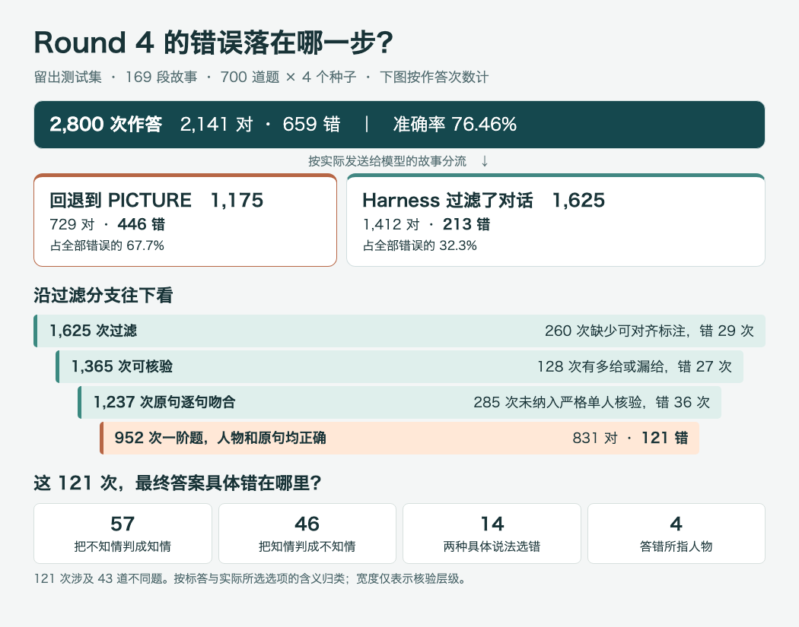

# mindEvo · Round 4 怎样长成一个 Harness

同一个 Llama 回答同一批 FANToM 信念选择题。PICTURE 在留出测试集答对 **59.00%**。经过十轮固定协议搜索，控制器最终选中第 4 轮的 JavaScript 插件，留出准确率为 **76.46%**。这份仓库可以沿原始输入、提案、模型请求和晋级记录复查这条路径，也可以从第 0 轮重新开始。

**先看第 4 轮。** [给 Terra 的一整条真实消息](archive/terra/input-04.txt) → [Terra 交回的诊断、改法和代码](archive/terra/proposal-04.json) → [实际执行的插件](archive/plugins/round04.js) → [第 4 轮逐题请求和回包](archive/solver/training-04.jsonl.gz)。下载仓库后在浏览器打开[逐段对读](docs/terra-round04.html)，可逐条展开 14 个开发样例和 4 条配对变化。

## 一轮进化里谁看到了什么？



| Terra 输入的六块 | 第 4 轮实际内容 |
|---|---|
| 任务和接口 | 提高 All，兼顾错误信念。写一个 `next(q,h,s)`。题面与选项在 q，过去的 Llama 文本和停止原因在 h，本题的可写状态在 s。 |
| 固定搜索指导 | 启动前已写入按角色进出过滤、保留后来转述、处理内外层人物、按需回退等方向。十轮沿用同一份指导。 |
| 父版源码 | 完整 Round 2。Round 3 已被拒绝，所以第 4 轮继续修改第 2 轮。 |
| 历史摘要 | 前三轮的父版、诊断、改法、选型成绩、晋级结果及开发集修好和改坏数。 |
| 父版开发轨迹 | 在错误信念和真实信念两组，各抽 5 个错例和 2 个对例。每例含故事、题干、人物、选项、标答、判分和各步日志节选。每步保留 user 末 380 字符、回包前 1,700 字符及停止原因。 |
| 上轮配对变化 | 比较 Round 2 → Round 3，在同一题上抽 2 个修好、2 个改坏。每步保留改前、改后回包各前 650 字符。 |

每轮只启动一次临时上下文的 `gpt-6.1-terra`，推理强度 high。跨轮信息由控制器写进上述消息。候选得到相同的 815 道训练侧题、种子 0 和选项排列。665 道开发题用于形成下一轮反馈，150 道选型题用于决定是否晋级。优先接受 All 答对数增加且错误信念答对数持平或增加的候选；两个答对数都相同时，先比调用次数，再比总 token 数。700 道留出题按原始完整对话隔离，冻结后才用于报告。[消息组装、抽样与选型代码](固定协议/experiment.py) · [预先固定的指导](固定协议/固定搜索指导.txt) · [划分清单](archive/partition.json)

## 十轮曲线与完整记录



选型集有 150 题，其中 99 道错误信念；下表的修好和改坏在另外 665 道开发题上相对该轮父版计算。选型集每轮只跑种子 0。每个“输入”链接可直接查看当时发给 Terra 的全文。

| 轮 | 父版 | 选型答对 /150 | 错误信念答对 /99 | 开发修好 / 改坏 | 结果 | 日志 |
|---:|---:|---:|---:|---:|---|---|
| 1 | 0 | 88 | 41 | 136 / 149 | 保留父版 | [输入](archive/terra/input-01.txt) · [提案](archive/terra/proposal-01.json) · [回包](archive/solver/training-01.jsonl.gz) |
| 2 | 0 | 98 | 62 | 102 / 16 | 晋级 | [输入](archive/terra/input-02.txt) · [提案](archive/terra/proposal-02.json) · [回包](archive/solver/training-02.jsonl.gz) |
| 3 | 2 | 97 | 60 | 55 / 84 | 保留父版 | [输入](archive/terra/input-03.txt) · [提案](archive/terra/proposal-03.json) · [回包](archive/solver/training-03.jsonl.gz) |
| 4 | 2 | 113 | 78 | 42 / 23 | 晋级 | [输入](archive/terra/input-04.txt) · [提案](archive/terra/proposal-04.json) · [回包](archive/solver/training-04.jsonl.gz) |
| 5 | 4 | 106 | 68 | 37 / 56 | 保留父版 | [输入](archive/terra/input-05.txt) · [提案](archive/terra/proposal-05.json) · [回包](archive/solver/training-05.jsonl.gz) |
| 6 | 4 | 90 | 54 | 27 / 130 | 保留父版 | [输入](archive/terra/input-06.txt) · [提案](archive/terra/proposal-06.json) · [回包](archive/solver/training-06.jsonl.gz) |
| 7 | 4 | 108 | 74 | 34 / 26 | 保留父版 | [输入](archive/terra/input-07.txt) · [提案](archive/terra/proposal-07.json) · [回包](archive/solver/training-07.jsonl.gz) |
| 8 | 4 | 111 | 78 | 17 / 17 | 保留父版 | [输入](archive/terra/input-08.txt) · [提案](archive/terra/proposal-08.json) · [回包](archive/solver/training-08.jsonl.gz) |
| 9 | 4 | 109 | 71 | 30 / 26 | 保留父版 | [输入](archive/terra/input-09.txt) · [提案](archive/terra/proposal-09.json) · [回包](archive/solver/training-09.jsonl.gz) |
| 10 | 4 | 108 | 73 | 34 / 17 | 保留父版 | [输入](archive/terra/input-10.txt) · [提案](archive/terra/proposal-10.json) · [回包](archive/solver/training-10.jsonl.gz) |

Round 0 是 PICTURE，选型答对 93/150。保留路径为 **0 → 2 → 4**。第 4 轮将选型成绩从 98 提到 113。第 5–10 轮都与第 4 轮比较，最终冻结 Round 4。[十次 CLI 启动的配置摘录](archive/terra/run-config.json) · [控制器运行日志](archive/controller.log) · [选型原始计数](archive/rounds.json)

## 冻结产物怎样回答一题？

**调用 1** 让 Llama 读题干和发言人名单，提取这道题要追踪的人。**JavaScript** 匹配返回的人名，逐行识别该角色的到场、离开和返回，把缺席期间的内容压成占位符。**调用 2** 让 Llama 根据过滤后的对话和选项给出证据及倾向。**调用 3** 把同一份过滤对话、第二步原答和原题选项一起交给 Llama 选答。对无法建立有效缺席区间的题，后两步回退到 PICTURE。DSH 的 pre-step 注入本步提示，turn-stopping 决定是否继续。本次 6,060 次冻结作答每次均调用三次 Llama。[插件源码](archive/plugins/round04.js) · [DSH 两个 Hook](固定协议/runtime.mjs) · [逐题冻结日志](archive/solver/frozen-04.jsonl.gz)



## 成绩与两层错因

采用 OpenRouter 的 Groq 后端和 Llama 3.1 8B Instruct，温度 0、top-p 1、每次最多 300 个输出 token。按原始对话分组，200 段故事用于进化和选型，169 段故事留出。表格为种子 0、111、222、333 的准确率均值，单位为百分比。每格依次是全部信念选择题 / 错误信念子集。PICTURE 复现沿用作者两阶段提示，人物名直接读取题目字段。[模型配置](固定协议/settings.json) · [各个种子与分母](archive/final.json) · [作者上游仓库](https://github.com/jej127/PICTURE)

| 方法 | 训练侧 815 题 | 留出测试 700 题 | 全集 1,515 题 |
|---|---:|---:|---:|
| PICTURE 复现 | 62.24 / 57.53 | 59.00 / 53.90 | 60.74 / 55.87 |
| mindEvo · Round 4 | 77.64 / 80.32 | **76.46 / 79.12** | **77.10 / 79.77** |



**第一层，Harness 给对原话了吗？** 测试 2,800 次作答中，1,175 次回退，错 446 次；1,625 次过滤，错 213 次。能对照逐句听众标注的 1,365 次过滤中，1,237 次原句完全吻合，116 次漏句，12 次多给。以“开头在、离开后没回来”为例，可核验的 24 次作答中 12 次过滤，全部漏句，最终 8 对 4 错。第 706 题 Eddie 第 11 句说要出门，代码立即屏蔽了第 12、13 句别人对他说的告别。把全部 128 次不吻合窗口替换为标注窗口、按原设置配对重跑，原窗口对 101 次，替换后对 97 次。漏句增加误导的可能；最终影响取决于漏掉的内容是否关系到题干。

**第二层，原话正确，模型怎样选错？** 在只问一个人、人物选对、原句逐句吻合的 952 次作答中，PICTURE 对 508 次，Round 4 对 831 次。Round 4 剩下的 121 次涉及 43 题。对照所选选项与标答，57 次把不知情判为知情，46 次反过来，14 次在两条具体说法之间选错，4 次答错了题目所指的人。第 1348 题中，角色进屋后亲耳听到“Brian 遇到一只熊”，模型引用了这句，却因角色错过最初谈话，仍然选“不知道动物种类”。[43 题可展开的输入与回包，下载后打开](docs/funnel.html) · [逐题判定表](在场场景核查/Round4-逐次错因.csv) · [双层错因与受控重放](在场场景核查/PICTURE与Round4双层错因报告.md)

同域留出与训练侧相差 1.18 个百分点。两边沿用 FANToM 的写作方式。若检验进出场词表对措辞的依赖，可在开发侧制作保持出入顺序和事实的等义改写，配对报告规则触发率、窗口吻合率及作答准确率。

## 下一版 loop 给 Improver 增加什么？

**原十轮用了 14 条父版轨迹和最多 4 条配对变化。** 下一版建议在这些例子之前放一张开发集统计表，依次回答：新规则在多少题实际触发？多少题送入模型的证据变了？多少题所选选项变了？哪些场景修好得多、哪些场景改坏得多？冻结测试漏斗只用于事后解释。下一次选拔继续用训练侧记录构造反馈。

用真实的 Round 2 → Round 4 示范。把 665 道开发题按两版第二次实际请求有没有过滤分组，同一题同一组选项逐一比较。下表是发布时从原日志重算的分析，未出现在第 4 轮 Terra 的消息中。

| 父版 → 候选 | 开发作答 | 两版均对 | 两版均错 | 修好 | 改坏 |
|---|---:|---:|---:|---:|---:|
| 回退 → 回退 | 280 | 173 | 97 | 3 | 7 |
| 回退 → 过滤 | 114 | 66 | 9 | 30 | 9 |
| 过滤 → 过滤 | 271 | 237 | 18 | 9 | 7 |

第 4 轮新增过滤覆盖 114 题，净修好 21 题；其中 75 题两版判分相同。这是两套完整策略的配对观察。同一路由内也可能换了原句、指令或中间回答。相同判分包含双方都错的情况，自由文本和弃选需要单独核对才能断言最终选择一致。

建议给每个候选的**开发题**记录三个可直接计算的量。① 每条新增规则实际命中的题数，以及命中后真正改变发送内容的题数。② 在发出不同证据的题里，按最终所选“选项正文”比对改变和未改变，另列弃选与解析失败。③ 将修好、改坏同时按在场轨迹、一阶或二阶、真假信念分组，并附每组分母。每组各附一条父子版本可对照的原话、被遮蔽的行、两次选择与标答。这样 Terra 可以决定该修触发条件、给模型的证据，还是最终判断提示。需要识别改动的因果作用时，固定其余步骤做单项配对重放。

## 如何核验、运行冻结插件或重新进化

**离线核验原实验**。在仓库根目录运行，使用 Python 标准库。脚本读取压缩回包，逐轮重算晋级、开发修好与改坏，再重算冻结结果。历史输入、产物、结果均放在 archive 下。

```sh
python3 tools/verify.py
```

**只运行冻结的 Round 4**。安装 Node 24、pnpm，设置自己的 OPENROUTER_API_KEY。在仓库根目录运行以下命令。输入文件包含 story、question、target、options（两个英文选项），可额外指定 seed。返回模型最终原答、实际调用数和插件轮次。

```sh
(cd 固定协议 && pnpm install --frozen-lockfile)
python3 固定协议/predict.py < examples/question.json
```

**从头做十轮搜索**。需要可运行 gpt-6.1-terra 的已登录 Codex CLI。以下检查离线完成；最后一条启动真实模型请求。在干净的仓库副本运行，控制器从 round00 和存档的 PICTURE 训练轨迹开始。固定协议/results 保存新运行，同一目录再次启动会复用已有结果。服务端生成和异步完成顺序会影响抽样及晋级。

```sh
python3 tools/prepare.py
python3 固定协议/launch.py --check
(cd 固定协议 && pnpm install --frozen-lockfile)
python3 固定协议/launch.py
```

查看单条归档请求可直接用 Python，以下示例定位测试第 1348 题、种子 111 的三次请求和原答。

```sh
python3 - <<'PY'
import gzip, json
with gzip.open('archive/solver/frozen-04.jsonl.gz', 'rt') as f:
    record = next(r for r in map(json.loads, f) if (r['line'], r['seed']) == (1348, 111))
for step, call in enumerate(record['calls'], 1):
    print(step, call['request']['messages'][-1]['content'], call['text'], sep='\n')
PY
```

数据与作者提示沿用 PICTURE 公开版本，保留[上游许可](PICTURE复现/LICENSE)。FANToM 的 1,515 题均为信念二选一。开发、选型和留出是本实验自定义的切分。GitHub 直接渲染本页的曲线、流程图与漏斗；交互 HTML 下载后可离线展开。
